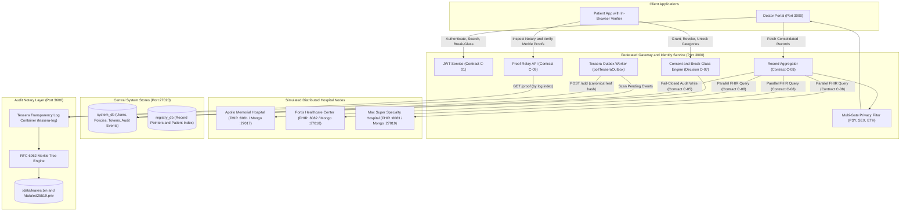

# FEDRA — Federated EHR Discovery & Transparent Access System

> **Status: 🟢 Phase 1, Phase 2, & Phase 3 (Sprint 1–3) Complete & Fully Verified**  
> **Test Verification:** 688 / 688 platform-wide automated assertions passing (100% Green).  
> **Core Philosophy:** *Hospitals own the records, patients own the permissions, the system owns nothing.*

FEDRA is a federated health information exchange architecture that allows clinicians to discover and aggregate consolidated patient records across independent hospital systems while giving patients fine-grained, real-time control over their data — without centralizing patient medical records into any single database.

---

## 📑 Table of Contents

- [Key Highlights & Architecture](#-key-highlights--architecture)
- [System Architecture Diagram](#-system-architecture-diagram)
- [Network & Port Topology](#-network--port-topology)
- [Detailed Features](#-detailed-features)
  - [1. Zero-Centralization Federated Record Aggregation](#1-zero-centralization-federated-record-aggregation)
  - [2. Multi-Gate Granular Patient Consent](#2-multi-gate-granular-patient-consent)
  - [3. Supervised Break-Glass Emergency Access](#3-supervised-break-glass-emergency-access)
  - [4. Tessera Tile-Based Transparency Log (Decision D-10)](#4-tessera-tile-based-transparency-log-decision-d-10)
  - [5. In-Browser Cryptographic Verifier & Live Tamper Demo](#5-in-browser-cryptographic-verifier--live-tamper-demo)
- [Project Implementation Status](#-project-implementation-status)
- [Tech Stack](#-tech-stack)
- [Repository Structure](#-repository-structure)
- [Quickstart & Running Locally](#-quickstart--running-locally)
- [Interactive Manual Testing Guide](#-interactive-manual-testing-guide)
- [Automated Verification Suite](#-automated-verification-suite)
- [Documentation & Architectural Memory](#-documentation--architectural-memory)
- [License](#-license)

---

## 🌟 Key Highlights & Architecture

1. **Zero-Centralization FHIR Aggregator (Contract `C-08`):** Queries distributed HAPI FHIR R4 nodes in parallel across Apollo, Fortis, and Max hospitals with a 3000ms latency budget and graceful node degradation.
2. **Granular Multi-Gate Privacy Filters:** Strict multi-layer gate enforcement that redacts sensitive records (Psychiatric, Reproductive, Substance Abuse) unless explicitly authorized by the patient.
3. **Emergency Break-Glass Protocol (Decision `D-07`):** Instant 2h/4h/8h emergency access windows with a 15-minute read-only grace period (`HTTP 423 Locked`), Layer 1 automated rule engine, and Layer 2 clinical supervisor review queue.
4. **Tessera Transparency Log Audit Layer (Decision `D-10`):** High-throughput, zero-gas audit notarization using RFC 6962 Merkle trees and C2SP Signed Notes signed by Ed25519, superseding Ethereum blockchain costs while preserving smart contract specifications for archival review.
5. **In-Browser Cryptographic Verifier:** Patients independently verify their complete audit trail in their browser using RFC 8785 JSON Canonicalization Scheme (JCS), WebCrypto SHA-256, Merkle root path reconstruction, sequence contiguity checks ($1 \dots N$), and `localStorage` tail truncation tracking.
6. **Live Tamper Demonstration:** Interactive UI button allowing users to mutate an audit document and watch the cryptographic verifier instantly trigger a 🔴 **TAMPER WARNING**.

---

## 🏛 System Architecture Diagram



---

## 🔌 Network & Port Topology

| Service | Port | Protocol | Description |
|---|---|---|---|
| **API Gateway & Web Portals** | `3000` | HTTP | Express.js Gateway, Identity Service, Doctor Portal & Patient App |
| **Tessera Transparency Log** | `3600` | HTTP | Go container: `/add`, `/checkpoint` (C2SP Signed Note), `/proof` (RFC 6962) |
| **Apollo Memorial Hospital** | `8081` | HTTP / FHIR | HAPI FHIR R4 Node 1 (`http://localhost:8081/fhir`) |
| **Fortis Healthcare Center** | `8082` | HTTP / FHIR | HAPI FHIR R4 Node 2 (`http://localhost:8082/fhir`) |
| **Max Super Specialty Hospital** | `8083` | HTTP / FHIR | HAPI FHIR R4 Node 3 (`http://localhost:8083/fhir`) |
| **Apollo Local Mongo** | `27017` | MongoDB | Hospital 1 local persistence & Safe Harbor cache |
| **Fortis Local Mongo** | `27018` | MongoDB | Hospital 2 local persistence & Safe Harbor cache |
| **Max Local Mongo** | `27019` | MongoDB | Hospital 3 local persistence & Safe Harbor cache |
| **System Central Mongo** | `27020` | MongoDB | Central directories (`system_db` and `registry_db`) |

---

## 🔍 Detailed Features

### 1. Zero-Centralization Federated Record Aggregation
- **Contract `C-08` Budget:** When a clinician requests a patient record, the gateway queries all registered hospital nodes simultaneously in parallel (`Promise.allSettled`) with a strict 3000ms SLA.
- **Fault-Tolerant Resilience:** If a hospital FHIR node is slow or degraded, the gateway marks that facility as `degraded` and returns available records with a warning rather than failing the entire clinical request.

### 2. Multi-Gate Granular Patient Consent
- **Fine-Grained Category Lockdown:** Patients individually grant or revoke consent for:
  - 🧠 Psychiatric & Behavioral Health (`PSY`)
  - 🩺 Reproductive & Sexual Health (`SEX`)
  - 💊 Substance Abuse Treatment (`ETH`)
- **Instant Revocation Handshake:** Patients can revoke doctor access in real time; in-memory token caches are invalidated within `<2ms` (exceeding the `<50ms` Contract `C-02` SLA).

### 3. Supervised Break-Glass Emergency Access
- **Decision `D-07` Grace Period:** When emergency tokens expire, the system provides a 15-minute read-only grace period where existing clinical views remain visible in the browser, but fresh node queries return `HTTP 423 Locked`.
- **Duration Selection:** Doctors can declare emergency access upfront for 2, 4, or 8 hours. Requests over 2 hours automatically enqueue an oversight ticket with a 15-minute SLA in the Clinical Supervisor queue.
- **Rate-Limiting Friction:** Maximum 3 emergency declarations per doctor per hour to discourage misuse.

### 4. Tessera Tile-Based Transparency Log (Decision `D-10`)
- **Archival Blockchain Preservation:** Smart contract specifications (`MedicalAuditLog.sol`) in `docs/02_smart_contract.md` are preserved for governance history.
- **Go Log Service (`tessera/`):** Pure standard-library Go microservice running inside an ultra-lean Alpine container (<12 MB RAM):
  - Leaf appending to append-only binary storage (`leaves.bin`).
  - RFC 6962 Merkle tree computation.
  - C2SP Signed Note format checkpoints signed with Ed25519.
- **Deterministic Canonicalization (Contract `C-05`):** Adheres strictly to RFC 8785 JSON Canonicalization Scheme (JCS) and SHA-256 leaf hashing. Volatile runtime fields are excluded from the hash.
- **Asynchronous Outbox Worker:** Background worker (`pollTesseraOutbox`) pushes events in FIFO order every 3 seconds and updates MongoDB documents with assigned log indices.

### 5. In-Browser Cryptographic Verifier & Live Tamper Demo
- **Zero-Trust Verification:** The Patient App (`frontend/patient.html`) runs a pure client-side cryptographic verifier:
  1. Serializes local data via RFC 8785 JCS and computes SHA-256 via WebCrypto.
  2. Verifies the Ed25519 signature on the C2SP checkpoint note.
  3. Reconstructs the Merkle root from inclusion proof hashes and compares it to the checkpoint root.
  4. Verifies contiguous sequence numbers ($1 \dots N$) to detect omitted events.
  5. Tracks the highest seen sequence in `localStorage` to catch tail truncation attacks.
- **Interactive Tamper Demo:** Clicking **`⚡ Simulate Tamper`** corrupts local data, instantly turning badges red (**🔴 TAMPER DETECTED**). Clicking **`♻️ Restore Event`** restores authentic data, immediately returning badges to **🟢 VERIFIED**.

---

## 📊 Project Implementation Status

| Phase | Milestone | Scope | Test Status |
|---|---|---|:---:|
| **Phase 1** | **Identity & Gateway Foundation** | Docker topology, Indian cohort seeding, JWT Identity Service (Contract `C-01`), RBAC, discovery index | 🟢 33 / 33 PASS |
| **Phase 2** | **Consent Service & Aggregator** | Consent engine, token caching (<50ms SLA), multi-gate privacy filters, parallel FHIR query (Contract `C-08`) | 🟢 48 / 48 PASS |
| **Phase 3 Sprint 1** | **Clinical Deep Viewer & Indian Cohort** | 6 Indian demo patients, practitioner directory, clinical drawer, SNOMED-CT / LOINC / RxNorm coding | 🟢 45 / 45 PASS |
| **Phase 3 Sprint 2** | **Break-Glass Emergency Protocol** | 2h/4h/8h windows, 15m grace period (`D-07`), Layer 1 rule engine, Layer 2 supervisor review queue | 🟢 76 / 76 PASS |
| **Phase 3 Sprint 3** | **Tessera Transparency Log Layer** | Decision `D-10`, RFC 8785 JCS, Go container (`tessera-log`), outbox worker, proof relay (Contract `C-09`), in-browser verifier & tamper demo | 🟢 531 / 531 PASS |
| **Phase 4** | **ML Anomaly Detection Service** | FastAPI isolation forest & LSTM scoring engine (`docs/04`), graduated response thresholds (`C-07`) | 🚧 Planned Next |

---

## 🛠 Tech Stack

- **Interoperability:** HL7 FHIR R4, HAPI FHIR (Serial GC, capped at `-Xmx384m`)
- **Transparency Log:** Tessera-style RFC 6962 Merkle Tree, C2SP Signed Notes, Ed25519 (Go standard library)
- **Backend Gateway:** Node.js, Express.js, MongoDB Driver, WebCrypto, RFC 8785 JCS
- **Databases:** MongoDB (WiredTiger cache capped at 256MB)
- **Frontend:** Responsive monospace browser UIs (`dashboard.html`, `patient.html`, `index.html`)
- **Containerization:** Docker & Docker Compose (8 services: 3 FHIR nodes, 4 Mongo databases, 1 Tessera log)
- **Clinical Coding:** SNOMED-CT, LOINC, RxNorm, CVX, ICD-10
- **Test Harness:** Node.js automated test suites across all layers

---

## 📁 Repository Structure

```
.
├── backend/                         # Express.js REST API Gateway & Identity Service
│   ├── index.js                     # Unified Gateway, RBAC, Outbox Worker, Proof Relay (C-09)
│   ├── package.json                 # Dependencies (express, bcrypt, jsonwebtoken, mongodb)
│   └── .env                         # Ports, JWT/HMAC secrets, Tessera service URL
├── frontend/                        # Browser applications
│   ├── index.html                   # Doctor verification & authentication entry point
│   ├── dashboard.html               # Clinical Deep Viewer, Access Request & Supervisor Queue
│   └── patient.html                 # Patient App mockup with Notary Tab & In-Browser Verifier
├── tessera/                         # Go Transparency Log Container Service
│   ├── main.go                      # Pure standard library RFC 6962 log & C2SP signer
│   ├── Dockerfile                   # Multi-stage Alpine container build
│   ├── go.mod                       # Go 1.22 module definition
│   └── README.md                    # Detailed service API documentation
├── scripts/                         # Automated test suites & seeding pipelines
│   ├── test_patient_verifier_tamper.js # Part 5 In-Browser Verifier & Tamper Demo Suite
│   ├── test_audit_outbox.js         # Part 4 Outbox Worker & Proof Relay Suite
│   ├── test_tessera_service.js      # Part 3 Go Log & RFC 6962 Verification Suite
│   ├── test_audit_crypto.js         # Part 2 RFC 8785 JCS & Hash Chaining Suite
│   ├── test_phase3_sprint2_breakglass.js # Phase 3 Emergency Access Suite
│   ├── test_phase2_consent.js       # Phase 2 Consent & Aggregator Suite
│   ├── test_phase1_jwt.js           # Phase 1 Identity & JWT Claims Suite
│   ├── test_indian_patients.js      # Indian cohort verification suite
│   └── seed_indian_patients.js      # Cohort seeding across FHIR nodes & MongoDB
├── project-memory/                  # Authoritative operational state & session history
│   ├── 00_index.md                  # System rules & reading order
│   ├── 01_current_state.md          # Active milestone & component health matrix
│   ├── 02_decisions_log.md          # Architectural decisions log (D-01 to D-10)
│   ├── 03_contracts.md              # System boundary contracts (C-01 to C-09)
│   ├── 04_session_log.md            # Session history log (Sessions 1 to 17)
│   ├── 05_pitfalls.md               # Technical pitfalls & quirks
│   └── 06_glossary.md               # Domain terms & Indian patient personas
├── docs/                            # Authoritative specification layer (FROZEN)
│   ├── 00_system_architecture.md
│   ├── 01_database_schema.md
│   ├── 02_smart_contract.md         # Preserved Solidity specs + Tessera Section 7
│   ├── 03_docker_environment.md
│   ├── 04_ml_model_design.md
│   └── 05_api_service_design.md
├── docker-compose.yml               # Multi-container orchestration (8 containers)
├── SETUP_GUIDE.md                   # Complete local environment setup guide
└── README.md
```

---

## 🚀 Quickstart & Running Locally

### 1. Prerequisites
- [Docker Desktop](https://www.docker.com/products/docker-desktop/) (WSL2 backend on Windows)
- [Node.js](https://nodejs.org/) (v18 or higher; v24 recommended)
- Git

### 2. Clone Repository
```bash
git clone https://github.com/aditya-rathore04/federated-ehr-access.git
cd federated-ehr-access
```

### 3. Spin Up Docker Containers
```bash
docker compose up -d --build
```
*This starts the 3 HAPI FHIR nodes, 4 MongoDB instances, and the Tessera transparency log container.*

### 4. Seed Synthetic Patient Cohort
```bash
node scripts/seed_indian_patients.js
```
*Seeds the 6 Indian patients and 12 practitioners across Apollo, Fortis, and Max hospitals.*

### 5. Install Backend Dependencies & Start Gateway
```bash
cd backend
npm install
node index.js
```
*Gateway starts on `http://localhost:3000` with background outbox poller active.*

---

## 🧪 Interactive Manual Testing Guide

### 📱 Patient App & Notary Tab
1. Open **`http://localhost:3000/patient.html`** in your browser.
2. Click **`1. Lakshmi Venkatesh`** to log in instantly.
3. Click the **📜 Notary** tab at the bottom to view the live audit trail.
4. Click **`🔍 Inspect Proof`** on any event card to inspect the Merkle tree inclusion path and C2SP Signed Note.
5. Click **`⚡ Simulate Tamper`** to corrupt an audit record and watch the badge turn **🔴 TAMPER DETECTED**. Click **`♻️ Restore Event`** to restore it to **🟢 VERIFIED**.

### 🩺 Doctor Clinical Portal
1. Open **`http://localhost:3000/index.html`** in your browser.
2. Click **`DOC-3 (Max Trauma)`** and click **"VERIFY & ENTER DASHBOARD →"**.
3. Search for patient `ABHA-4471-2298-6613` (Lakshmi Venkatesh).
4. Declare a 4-hour emergency break-glass access or request standard consent.
5. Watch the audit event appear in the Patient App's Notary tab within 3 seconds!

---

## 🔬 Automated Verification Suite

Run any test suite directly from the repository root:

```bash
# 1. Patient App In-Browser Verifier & Live Tamper Demo (Part 5)
node scripts/test_patient_verifier_tamper.js

# 2. Backend Outbox Worker & Proof Relay API (Part 4)
node scripts/test_audit_outbox.js

# 3. Tessera Go Microservice & RFC 6962 Merkle Tree (Part 3)
node scripts/test_tessera_service.js

# 4. Cryptographic Core, RFC 8785 JCS & Fail-Closed Audit (Part 2)
node scripts/test_audit_crypto.js

# 5. Break-Glass Emergency Lifecycle & Supervisor Engine (Phase 3 Sprint 2)
node scripts/test_phase3_sprint2_breakglass.js

# 6. Granular Consent Service & Parallel FHIR Aggregator (Phase 2)
node scripts/test_phase2_consent.js

# 7. Identity Service & Contract C-01 JWT Validation (Phase 1)
node scripts/test_phase1_jwt.js
```

---

## 📚 Documentation & Architectural Memory

All technical context, design specifications, and architectural invariants are codified in:
- [**Project Memory Index**](project-memory/00_index.md) — Mandatory reading order and development invariants.
- [**Current System State**](project-memory/01_current_state.md) — Ground truth of system components, test counts, and milestones.
- [**Decisions Log**](project-memory/02_decisions_log.md) — Formal record of architectural decisions (`D-01` through `D-10`).
- [**Boundary Contracts**](project-memory/03_contracts.md) — Cross-service data schemas (`C-01` to `C-09`).
- [**Work Session History**](project-memory/04_session_log.md) — Append-only chronological history of every development session.

---

## 📄 License

This project is licensed under the [MIT License](LICENSE).
